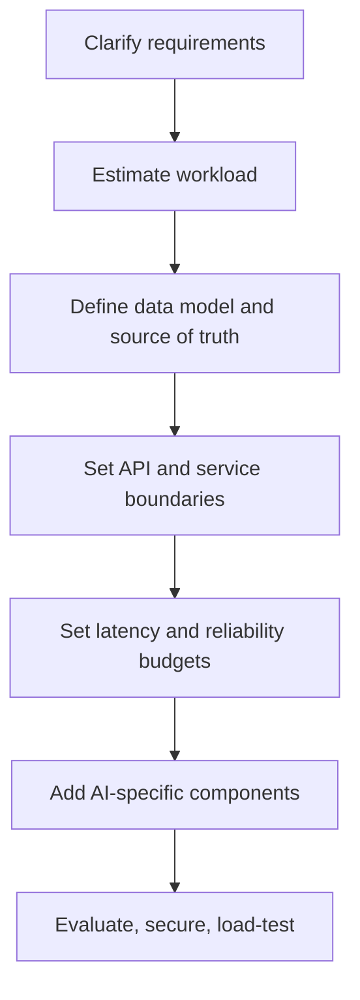

# Lesson 89 — System Design Fundamentals

> Before designing AI systems, learn to design systems. AI adds probabilistic behavior and inference cost; it does not remove the fundamentals.

## 1. Requirements before technology

### Functional requirements

Describe user-visible behavior:

- A user asks a question and receives an answer grounded in authorized documents.
- An engineer asks an agent to fix a bug and receives a reviewable pull request.
- An analyst asks a question and receives a governed result and visualization.

### Non-functional requirements

Describe service quality:

- **Latency:** median, p95, and p99.
- **Availability and recovery:** uptime expectations, recovery time, and acceptable data loss.
- **Quality:** correctness, groundedness, and task completion.
- **Security:** privacy, authorization, auditability, and data residency.
- **Cost:** cost per request and per successful task.
- **Freshness:** how quickly changes must become searchable.

### Operational requirements

Deployment, rollback, alerts, model and prompt versioning, retention, deletion, incident response, and ownership.

### Requirements template

```text
Users and primary use case:
Critical user journeys:
Functional requirements:
Latency target (p50 / p95 / p99):
Availability target:
Quality / risk threshold:
Expected average and peak traffic:
Input/output token distribution:
Data sources and freshness:
Security and compliance:
Cost ceiling:
Fallback behavior:
Success metrics:
Out of scope:
```

## 2. Estimate workload

Let `DAU` be daily active users and `r` be requests per user per day.

```text
requests/day = DAU × r
average QPS = requests/day ÷ 86,400
peak QPS = average QPS × peak-to-average factor
```

Example assumptions: 100,000 daily active users, 8 requests per user per day, and a peak factor of 5.

```text
requests/day = 100,000 × 8 = 800,000
average QPS = 800,000 / 86,400 ≈ 9.26
peak QPS ≈ 9.26 × 5 ≈ 46.3
```

These are planning estimates, not measurements. Validate them with traffic data and load tests.

## 3. Estimate model cost

```text
input cost = input tokens / 1,000,000 × input price per 1M tokens
output cost = output tokens / 1,000,000 × output price per 1M tokens
request cost = input cost + output cost
daily model cost ≈ requests/day × average request cost
```

Use current provider pricing for real estimates. Include retries, embeddings, reranking, tool calls, storage, observability, and idle capacity. For a multi-step workflow, estimate each step's expected frequency and cost. Track p50, p95, and worst-case task cost.

## 4. Latency budgets

```text
end-to-end latency
  = queueing
  + sequential work
  + longest parallel branch
  + response delivery
```

Instrument each stage. Streaming can improve time-to-first-token (TTFT), but does not make the final answer faster or more correct. Measure TTFT and time-to-completion separately.

## 5. Data and API fundamentals

- Use a transactional database as the source of truth for mutable business state.
- Treat caches, vector indexes, and search indexes as derived data that can be rebuilt.
- Keep audit events append-only where practical.
- Use explicit schemas, pagination, authentication, authorization, and request limits.
- Use idempotency keys for retried requests that cause side effects.
- Use streaming such as SSE for progressive text; use WebSockets when bidirectional interaction is required.
- Use queues for asynchronous work and durable retries.
- Use gRPC when internal service contracts and performance justify the operational complexity.

## 6. Reliability patterns

- **Timeouts:** bound every external call.
- **Retries:** retry transient failures with exponential backoff and jitter.
- **Idempotency:** prevent retries from duplicating payments, refunds, or ticket mutations.
- **Circuit breakers:** stop repeatedly calling a failing dependency.
- **Bulkheads:** isolate resource pools so one workload cannot starve all others.
- **Backpressure:** reject, defer, or shed load before queues grow without bound.
- **Dead-letter queues:** retain messages that exhaust retry policy for investigation.
- **Graceful degradation:** preserve safe core functionality when optional components fail.

## Architecture flow



## Exercise

Design a document-question-answering service for 5,000 employees. State assumptions, calculate average and peak QPS, estimate model cost, draw the architecture, and identify the first three likely bottlenecks. Your assumptions and reasoning must be inspectable.
