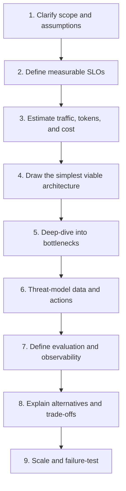

# Lesson 90 — The AI System Design Framework

## The ten questions

1. **Who is the user?** Internal operator, developer, analyst, or external customer?
2. **What is the task?** Answer, search, classify, generate, decide, or take an action?
3. **What is the risk of error?** Could a mistake cause financial, privacy, legal, or safety harm?
4. **What data is available?** Who may access it, and how fresh must it be?
5. **What are the workload and latency requirements?** Include concurrency, peak load, and long-running tasks.
6. **What is the cost ceiling?** Per request, per successful task, and per active user?
7. **Does the system need tools or external actions?** What permissions and approval rules apply?
8. **What must be protected?** PII, tenant boundaries, credentials, proprietary data, and audit records.
9. **How will quality be measured?** Define offline tests, online metrics, and release gates before launch.
10. **What happens when a component fails?** Define timeout, fallback, abstention, retry, escalation, and recovery behavior.

## A repeatable design sequence

## Select the simplest approach that works

| Requirement | First approach to consider | Caveat |
|---|---|---|
| Stable transformation or extraction | Deterministic code plus schema validation | Avoid a model if rules solve it reliably |
| Fresh facts from private documents | RAG | Retrieval quality and permissions matter |
| Live public information | Search with source verification | Sources can be stale or conflicting |
| Consistent style or output format | Structured prompts; consider fine-tuning after measurement | Fine-tuning does not provide current facts |
| Multi-step work with tools | Bounded workflow or agent | Add permissions, budgets, and stop conditions |
| Independent subtasks | Parallel workers when independence is real | Merge conflicts and rate-limit bursts |
| Predictable business process | Explicit workflow/state machine | Usually more controllable than an unconstrained agent |

RAG, fine-tuning, and agents solve different problems and can be combined. Do not add an agent simply because a product is described as AI-powered.

## Core building blocks

- **Model gateway:** provider abstraction, timeouts, retries, quotas, routing, and usage accounting.
- **Prompt and schema versioning:** prompts are deployable artifacts; validate structured outputs.
- **Retrieval:** lexical and semantic search, metadata filters, reranking, source permissions, and freshness.
- **Workflow/state store:** durable execution state, checkpointing, retries, and resume behavior.
- **Tool gateway:** typed definitions, authorization, input validation, audit logging, and rate limits.
- **Evaluation:** versioned datasets, task-specific metrics, regression gates, and human review.
- **Observability:** correlated traces, model and prompt versions, token use, latency, tool outcomes, and errors.
- **Policy enforcement:** tenant isolation, access control, approval requirements, retention, and safety controls.

## Architecture decision record (ADR)

For each major decision, record context, decision, alternatives, trade-offs, security implications, cost/latency implications, validation plan, and conditions that would cause reconsideration.

## Deliverable

Produce a one-page design brief and two ADRs. A reviewer should be able to challenge assumptions without guessing why you chose a vector database, model, queue, or agent.
