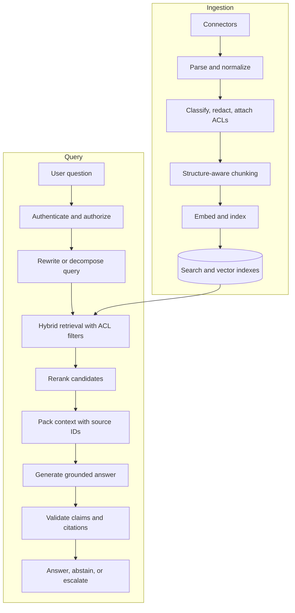

# Lesson 91 — Enterprise RAG Knowledge Base

## Scenario

Build an assistant over internal and customer-facing documents. It must enforce document permissions, cite evidence, abstain when evidence is insufficient, and meet a defined latency objective.

## Architecture

## Ingestion design

1. Connect to authoritative sources and preserve IDs, versions, timestamps, and ownership.
2. Parse PDFs, HTML, office files, and tables; detect extraction failures.
3. Apply classification, redaction, tenant metadata, and access-control metadata.
4. Split on headings and semantic boundaries while respecting token limits.
5. Store chunks with stable IDs and source locations.
6. Embed and index asynchronously; make ingestion idempotent.
7. Track source version and index status; re-index changed documents incrementally.
8. Propagate deletion and permission changes to indexes and caches.

A vector index is not the source of truth. Treat indexing as a recoverable, observable data pipeline.

## Retrieval and generation

- Use lexical retrieval for exact names, IDs, and error codes alongside dense retrieval for semantic matches when evaluation supports it.
- Apply authorization filters before results reach the model. Never rely on prompt instructions to enforce access control.
- Merge candidates, deduplicate, and rerank them.
- Pack evidence based on relevance, diversity, token budget, and source quality.
- Require citations to refer to retrieved source IDs and precise spans.
- Verify that each material claim is supported; abstain or ask a clarifying question when evidence is insufficient.
- Distinguish “no evidence found” from “the answer is false.”

## Trade-offs

| Decision | Options | How to choose |
|---|---|---|
| Chunking | Fixed-size vs. structure-aware | Compare retrieval and answer quality |
| Retrieval | Dense vs. hybrid | Test exact identifiers and semantic questions |
| Freshness | Batch vs. incremental indexing | Use source update frequency and freshness SLO |
| Generation | Large context vs. retrieve/rerank | Measure quality, latency, and cost |
| Cache | Exact vs. semantic | Test freshness, permissions, and false matches |

Semantic caches must be scoped by tenant, identity/permissions, data version, and freshness policy. A cache hit must never bypass authorization.

## Evaluation

Create a versioned dataset containing:
- Answerable questions with expected evidence.
- Unanswerable questions that should trigger abstention.
- Exact-identifier and multi-hop questions.
- Conflicting or outdated documents.
- Permission-boundary cases.
- Prompt-injection content inside retrieved documents.

Measure retrieval recall@k, ranking quality, citation correctness, groundedness, completeness, abstention precision/recall, p95 latency, and cost per successful answer. Use human review for high-impact cases. No single LLM-as-judge score proves correctness.

## Failure handling

- Empty or weak retrieval → abstain or clarify.
- Index lag → expose freshness state and optionally query the source system.
- Embedding/reranking outage → use a fallback only if its quality is known.
- Permission update → invalidate affected indexes and caches promptly.
- Model outage → return a clear retryable error or vetted cached result within freshness policy.

## Project

Implement ingestion, hybrid retrieval, citations, a 30–100 question evaluation set, permission filters, traces, and a regression report. Publish measured results and limitations, not unsupported accuracy claims.
