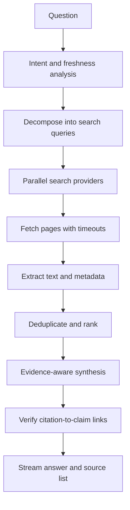

# Lesson 92 — AI Search and Answer Engine

## Scenario

A user asks about current information. The system searches multiple sources, synthesizes a concise answer, streams progress, and provides verifiable citations.

## Architecture

## Design details

- Decompose comparisons and multi-part questions into focused searches.
- Use parallel fan-out with per-provider deadlines and a global time budget.
- Respect source access rules, robots policies, provider terms, and rate limits.
- Extract main content and retain URL, title, publication date, fetch time, and relevant spans.
- Rank by relevance, freshness, and source quality; do not equate popularity with truth.
- Require citations for externally verifiable claims and ensure citations support the specific claim.
- Distinguish primary sources, reporting, opinion, and user-generated content.
- State uncertainty and conflicting evidence instead of inventing consensus.

## Latency and resilience

Search providers and page fetches are external dependencies. Set timeouts, cap fan-out, cancel unnecessary work, and synthesize from sufficient evidence that arrived within the deadline. Do not let one slow page block every result.

Cache search results separately from generated answers. Search-result caches need freshness policies; answer caches need stricter invalidation because facts change. Do not cache private or personalized results across users.

## Evaluation

Track query coverage, source diversity, freshness, claim support, citation precision, citation completeness, answer usefulness, latency, and cost. Test time-sensitive questions, ambiguous queries, conflicting sources, dead links, and adversarial pages.

## Project

Build a search prototype with query decomposition, parallel retrieval, page extraction, source cards, claim-level citation checks, and a benchmark of questions with expected source evidence.
