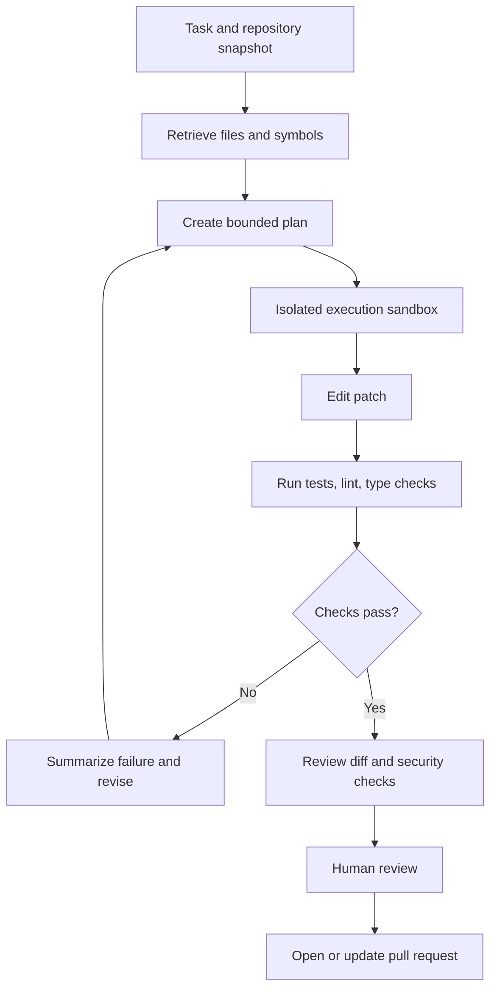

# Lesson 93 — Coding Agent

## Scenario

An agent reads a repository, plans a change, edits files, runs tests, and proposes a reviewable pull request without unrestricted access to the host or production environment.

## Architecture

## Safe execution boundary

Treat repository content, issue text, comments, dependencies, and test output as untrusted input. They may contain prompt injection or malicious instructions.

- Use ephemeral isolated containers or VMs with resource and wall-clock limits.
- Do not mount host secrets or production credentials into the sandbox.
- Default to no network; allow-list required package registries or services.
- Use least-privilege repository tokens scoped to the task.
- Separate planning permissions from execution permissions.
- Validate tool calls and file paths; prevent path traversal and writes outside the workspace.
- Capture commands, exit codes, resource use, patches, and logs.
- Require human review before merge; high-risk operations need explicit approval.

## Agent loop controls

Set maximum iteration count, token budget, wall-clock budget, tool-call budget, and diff-size limit. Detect repeated commands and unchanged failures. Preserve the partial patch and test results when the budget is exhausted.

Do not let the agent “solve” a failing test by silently deleting or weakening assertions. Flag test modifications and require extra review. Keep acceptance criteria separate from the agent's proposed implementation.

## Evaluation

Use task success on held-out repository issues, tests passed, regression rate, patch quality, review acceptance, time-to-resolution, and cost per successfully resolved task. Test malicious repository instructions, dependency-install failure, flaky tests, timeout, permission denial, and sandbox escape attempts.

## Project

Build a sandboxed agent for a small sample repository. Demonstrate a successful fix, a failed task that returns a useful partial result, a malicious-input test, and an audit trace. Never run generated code on production systems.
