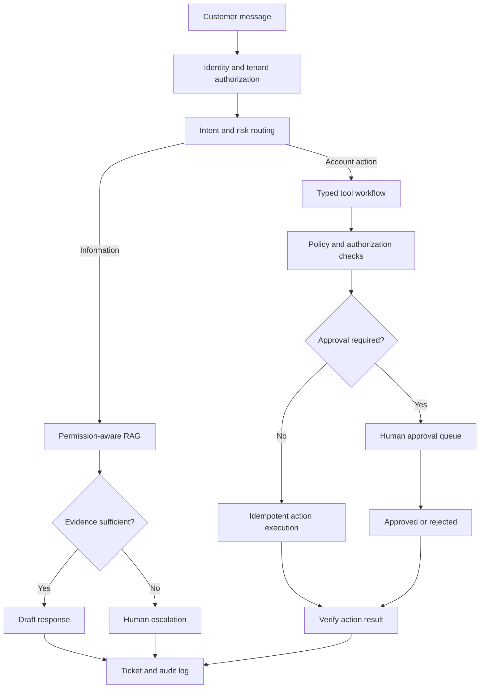

# Lesson 94 — Customer Support AI

## Scenario

An assistant answers policy and product questions, looks up customer-specific information, performs approved low-risk actions, and escalates uncertain or high-impact cases to a human.

## Architecture

## Essential design rules

- Ticket and account systems are the source of truth, not model memory.
- Re-check identity, authorization, and current state immediately before an action.
- Define risk tiers by impact and reversibility: read-only lookup, reversible profile update, refund, account closure.
- Require approval for actions beyond configured thresholds or with irreversible impact.
- Use idempotency keys and record actor, intent, arguments, approval, result, and correlation ID.
- Tell the customer what was actually done; do not claim success until the tool confirms it.
- Escalate low-confidence answers, policy conflicts, sensitive requests, and repeated tool failures.
- Keep a human-readable transcript and resume state after restarts.

## Metrics

Measure resolution rate alongside customer satisfaction, reopen rate, escalation appropriateness, policy compliance, action success, refund error rate, latency, and cost per resolved ticket. Sample auto-resolved cases for human audit. A high deflection rate is not success if customers must contact support again.

## Project

Integrate a mock ticket system and mock account API. Implement policy-based approval, idempotent actions, audit logs, replayable test scenarios, and human escalation.
