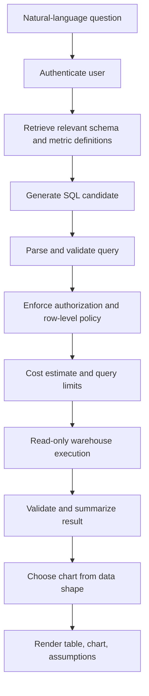

# Lesson 95 — AI Analytics Platform: Natural Language to SQL

## Scenario

A user asks a business question, the system identifies relevant schema, generates a query, executes it under enforced access controls, and returns a table and suitable chart.

## Architecture

## Security is enforced outside the model

- Use a dedicated read-only database role with least privilege.
- Parse SQL into an AST; allow only approved statements and schemas.
- Reject DDL, DML, multiple statements, dangerous functions, and unapproved objects.
- Apply row- and column-level policies in the database or trusted query layer, never only in the prompt.
- Use parameterized queries for values and strict allow-lists for identifiers.
- Set statement timeouts, concurrency quotas, scan limits, and result-row limits.
- Protect against sensitive inference and aggregation attacks; suppress results where policy requires.
- Log user identity, schema version, normalized query, execution stats, and policy decisions without leaking secrets.

A read replica is not a security boundary by itself. Authorization, read-only permissions, query validation, resource limits, and data policies are still required.

## Semantic correctness

A syntactically valid query can still answer the wrong question. Maintain governed metric definitions, join relationships, date semantics, timezone rules, currency handling, and business glossary terms. If “best customer” or “last quarter” is ambiguous, ask a clarifying question or state the assumption.

Validate generated queries against representative questions and known expected results. Evaluate semantic accuracy, execution success, policy violations, latency, warehouse cost, and chart appropriateness.

## Project

Build a prototype over a synthetic warehouse. Include schema retrieval, SQL parsing, read-only execution, enforced tenant filters, query timeouts, a small gold dataset, and charts. Include adversarial tests that attempt data exfiltration.
