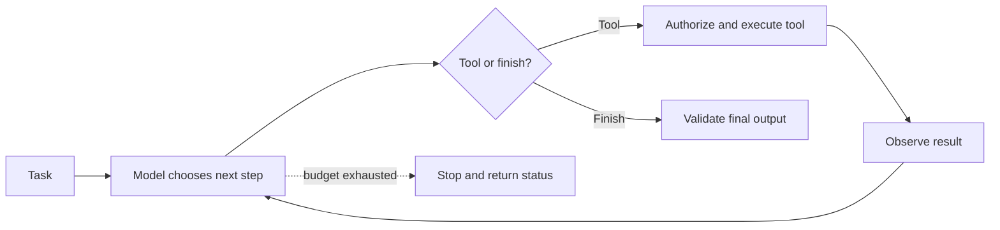
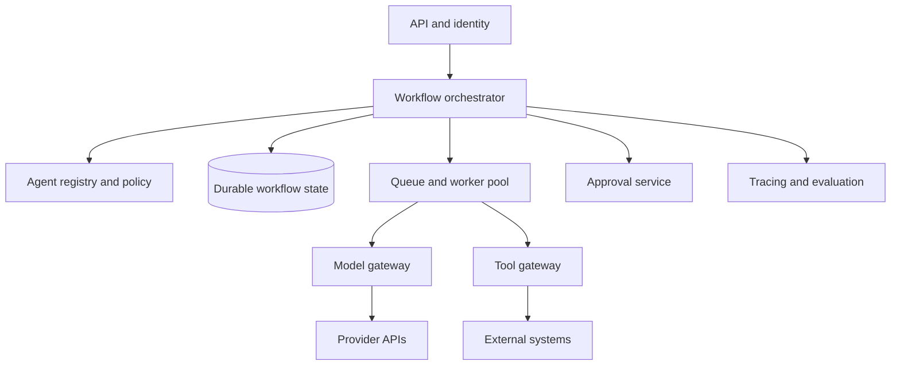

# Lesson 96 — Multi-Agent Platform and Orchestration

## Start with the single-agent loop

An agent is a control loop with state, tools, observations, termination conditions, and an execution policy—not just a prompt.

## Orchestration patterns

| Pattern | Use when | Main risk |
|---|---|---|
| Sequential workflow | Steps and dependencies are known | An early failure blocks later steps |
| Router/supervisor | Requests belong to distinct categories | Misrouting or supervisor bottleneck |
| Parallel workers | Subtasks are independent | Conflicting results and rate-limit bursts |
| Critic/reflection | A review pass can detect meaningful defects | Extra cost without quality gain |
| Hierarchical planner | Large tasks can be decomposed and verified | Planning drift and uncontrolled expansion |
| Human approval | Actions have significant impact or uncertainty | Queue delays and unclear ownership |

Do not use multi-agent orchestration by default. Compare it against a single model call and deterministic workflow. More agents can mean more latency, cost, failure surfaces, and harder debugging.

## Platform architecture

## Platform capabilities

- **Agent registry:** version, owner, tools, permissions, model preferences, limits, and purpose.
- **Durable state:** persist workflow state and checkpoints; resume after worker crashes.
- **Typed messages:** explicit input/output schemas, correlation IDs, and versioning.
- **Global budgets:** workflow-level token, cost, wall-clock, tool-call, and concurrency limits.
- **Shared rate limiting:** coordinate limits across agents calling the same external provider.
- **Policy gateway:** authorize every tool call at execution time.
- **Observability:** correlate user request, workflow, agent, model call, and tool call in one trace.
- **Human approval:** reusable, auditable pause/resume primitive.
- **Cancellation:** propagate user cancellation and stop unnecessary work.
- **Replay and recovery:** retain enough state to diagnose failures without replaying unsafe side effects.

## State and concurrency

Persist workflow state in a durable store. Redis can support low-latency coordination, but an ephemeral cache alone is not a durable source of truth. Use database transactions, leases, optimistic concurrency, or idempotent transitions to prevent workers from applying the same transition incorrectly.

Parallel agents should receive only the data they need. Merge outputs through a schema and validation step, not by concatenating arbitrary text.

## Project

Create a workflow engine with two specialized workers, a supervisor, checkpoint/resume, shared rate limits, per-workflow budgets, cancellation, and end-to-end tracing. Demonstrate recovery from a worker crash and a provider rate-limit response.
