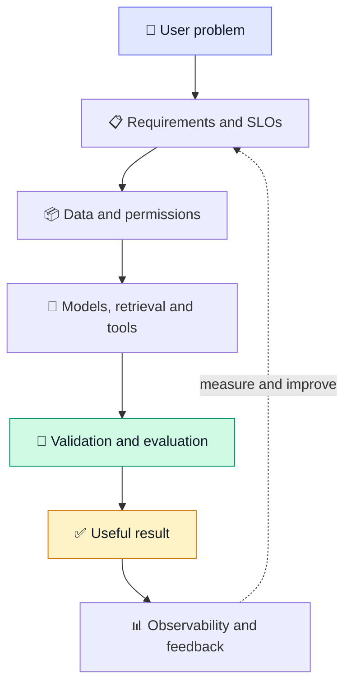
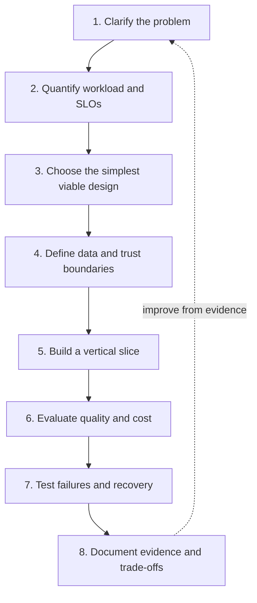

 <div align="center">

# 🏛️ AI System Design
### Volume VIII · AI Systems Engineer Handbook

**From “let’s add AI” to systems you can trust in production.**

Design intelligent systems. Challenge architectural assumptions. Measure what matters. Build for failure.

[🚀 Start Learning](#-choose-your-mission) · [🗺️ Explore the Roadmap](#️-your-learning-journey) · [🏗️ Build a Capstone](#-choose-your-build) · [✅ Test Your Design](#-production-readiness-check)


</div>

---

> [!IMPORTANT]
> **The best AI architecture is not the most complicated one.**
>
> It is the simplest design that satisfies the requirements, respects the security boundaries, meets the quality and latency targets, and stays within budget—with evidence to prove it.

## ⚡ Welcome to the world beyond the demo

A prototype answers one question:

*Can we make it work?*

Production asks much harder ones.

- 🔎 Can the system support its answers with evidence—or recognize when it does not know?
- 🔐 Can it protect sensitive data across retrieval, tools, caches, and multiple tenants?
- 🧯 Can it recover when a provider times out, a worker crashes, or a budget is exhausted?
- 💸 Can you explain the cost of a successfully completed task?
- 🧪 Can another engineer reproduce your evaluation and challenge your assumptions?
- 📈 Can you detect quality regressions before users discover them?

This volume is about answering those questions through engineering.

You will work through the design of enterprise knowledge systems, AI search, coding agents, customer support automation, analytics platforms, and multi-agent workflows. You will also practise the less glamorous—and more important—work behind reliable AI: capacity planning, evaluation, authorization, observability, failure recovery, and architectural trade-offs.

**The mission:** learn to design AI systems that are not merely impressive in a demo, but understandable, testable, secure, and operable.

<details>
<summary><strong>🧠 The entire idea in one diagram</strong></summary>



The model is only one component. The system around it determines what information it can access, what actions it can perform, how its output is checked, and what happens when something goes wrong.

</details>

---

## 🎮 Choose your mission

**What do you want to build?** Start with the mission that matches your interests. Each one links to the relevant lesson.

| Your mission | Start here | Skills you'll develop |
|---|---|---|
| 🧱 **Master system design fundamentals** | [Lesson 89](89-system-design-fundamentals.md) | Requirements, capacity, latency, reliability |
| 🧠 **Learn an AI architecture framework** | [Lesson 90](90-ai-system-design-framework.md) | Architecture selection, trade-offs, design reviews |
| 📚 **Build an enterprise knowledge assistant** | [Lesson 91](91-enterprise-rag.md) | Retrieval, citations, permissions, abstention |
| 🌐 **Build an AI research engine** | [Lesson 92](92-ai-search.md) | Search, evidence collection, synthesis |
| 👩‍💻 **Build a coding agent** | [Lesson 93](93-coding-agent.md) | Sandboxing, code edits, tests, review |
| 🎧 **Automate customer support** | [Lesson 94](94-customer-support-ai.md) | Authorized actions, approval, escalation |
| 📊 **Build AI-powered analytics** | [Lesson 95](95-ai-analytics-platform.md) | Natural-language SQL, governance, validation |
| 🕸️ **Design a multi-agent platform** | [Lesson 96](96-multi-agent-platform.md) | Orchestration, durable state, budgets, tracing |

<details>
<summary><strong>🌱 New to AI system design? Follow this path.</strong></summary>

1. Read [89 — System Design Fundamentals](89-system-design-fundamentals.md).
2. Learn the repeatable process in [90 — AI System Design Framework](90-ai-system-design-framework.md).
3. Build the [AI Knowledge Platform](capstones/knowledge-platform.md).
4. Add an evaluation dataset and threat model before expanding the feature set.
5. Move on to tool-using systems once your first end-to-end workflow is reliable.

**Your rule:** build one reliable vertical slice before adding more components.

</details>

<details>
<summary><strong>⚡ Already experienced? Take the engineering challenge.</strong></summary>

1. Write a design brief using [Lesson 90](90-ai-system-design-framework.md).
2. Choose the lesson most relevant to your current project.
3. Define your threat model and evaluation criteria before implementation.
4. Introduce a realistic failure and demonstrate recovery.
5. Document the most important architectural decisions.

Skip the unnecessary repetition—not the evaluation, security, or failure testing.

</details>

---

## 🗺️ Your learning journey

Eight lessons take you from fundamentals to complete AI platforms.

| Stage | Lesson | The question you'll answer | Deliverable |
|:---:|---|---|---|
| `01` | [System Design Fundamentals](89-system-design-fundamentals.md) | What must the system do, and what will it cost? | Requirements and capacity worksheet |
| `02` | [AI System Design Framework](90-ai-system-design-framework.md) | Which architecture actually fits the requirements? | Design brief and architecture decisions |
| `03` | [Enterprise RAG](91-enterprise-rag.md) | How do we answer from authorized, current evidence? | RAG prototype and evaluation report |
| `04` | [AI Search](92-ai-search.md) | How do we collect and verify evidence? | Search prototype and citation checks |
| `05` | [Coding Agent](93-coding-agent.md) | How can an agent modify code safely? | Sandboxed edit-test-review workflow |
| `06` | [Customer Support AI](94-customer-support-ai.md) | Which actions should be automated or approved? | Controlled action flow and audit trail |
| `07` | [AI Analytics Platform](95-ai-analytics-platform.md) | How do we turn questions into governed queries? | NL-to-SQL prototype and security tests |
| `08` | [Multi-Agent Platform](96-multi-agent-platform.md) | How do agents coordinate and recover within a budget? | Durable orchestration and tracing |

### 🔄 The architecture decision loop

Apply this process to every design exercise and capstone.



<details>
<summary><strong>📅 Suggested study plan</strong></summary>

| Phase | Focus | Exit condition |
|---|---|---|
| Foundation | Lessons 89–90 | You can explain requirements, estimates, and alternatives |
| Application systems | Lessons 91–95 | You can build and evaluate an end-to-end AI workflow |
| Platform engineering | Lesson 96 | You can explain orchestration, budgets, cancellation, and recovery |
| Capstone | Choose one project | You have reproducible tests, measurements, and documented limitations |

Move at a pace that gives you time to implement and test. Finishing a lesson is not the same as mastering its engineering decisions.

</details>

---

## 🏗️ Choose your build

Six capstones turn the theory into practical engineering work. Open a project to explore its scope, requirements, and acceptance criteria.

<details>
<summary><strong>📚 01 — AI Knowledge Platform</strong> · Retrieval, citations, permissions</summary>

**[Open the capstone specification →](capstones/knowledge-platform.md)**

Build a document ingestion pipeline, hybrid retrieval, source-grounded answers, access-control filtering, abstention, tracing, and offline evaluation.

**Your system must demonstrate:**
- Unauthorized documents never enter model context.
- Document updates and deletions propagate correctly.
- Weak evidence leads to abstention or clarification.
- Evaluation results can be reproduced.

</details>

<details>
<summary><strong>👩‍💻 02 — AI Coding Agent</strong> · Sandboxed edits, tests, review</summary>

**[Open the capstone specification →](capstones/coding-agent.md)**

Build a bounded agent that explores a repository, proposes edits, runs checks, and prepares a reviewable patch in an isolated environment.

**Your system must demonstrate:**
- Host and production secrets are not exposed to the sandbox.
- Execution, network, and resource access are restricted.
- Iteration and cost budgets are enforced.
- Failed tests are reported honestly.
- A human approves changes before merging.

</details>

<details>
<summary><strong>🔬 03 — AI Research Platform</strong> · Evidence, synthesis, citations</summary>

**[Open the capstone specification →](capstones/research-platform.md)**

Build query decomposition, parallel source collection, evidence-aware synthesis, citation verification, and resumable workflow state.

**Your system must demonstrate:**
- Source evidence and metadata are retained.
- Conflicting evidence is surfaced.
- Worker failures do not corrupt workflow state.
- Citation checks and cost limits are tested.

</details>

<details>
<summary><strong>🎧 04 — Enterprise Customer Support AI</strong> · Controlled actions, escalation</summary>

**[Open the capstone specification →](capstones/customer-support-ai.md)**

Build a support assistant using policy-aware retrieval, authorized account tools, risk-based approval, and human escalation.

**Your system must demonstrate:**
- Actions are authorized, idempotent, and auditable.
- High-impact operations require approval.
- The assistant never claims an unconfirmed action succeeded.
- Resolution quality is measured alongside automation rates.

</details>

<details>
<summary><strong>📊 05 — AI Analytics Platform</strong> · NL-to-SQL, data governance</summary>

**[Open the capstone specification →](capstones/analytics-platform.md)**

Build schema retrieval, SQL generation and parsing, read-only execution, enforced data policies, and result visualization.

**Your system must demonstrate:**
- Dangerous statements and unauthorized access are blocked outside the prompt.
- Query and resource limits are enforced.
- Ambiguous questions trigger clarification or documented assumptions.
- Known-answer tests catch semantic errors.

</details>

<details>
<summary><strong>🕸️ 06 — Composable AI Platform</strong> · Orchestration, budgets, recovery</summary>

**[Open the capstone specification →](capstones/composable-ai-platform.md)**

Build agent registration, durable workflows, model and tool gateways, shared limits, approvals, cancellation, and end-to-end traces.

**Your system must demonstrate:**
- Workflows resume after worker restarts.
- Cancellation stops unnecessary work.
- Provider limits are enforced across workflows.
- Traces connect the request, agents, model calls, and tools.

</details>

### 🏆 The capstone quality bar

A working demo is the beginning—not the finish line.

- [ ] Clear README, architecture diagram, and setup instructions.
- [ ] Reproducible setup and synthetic demo data where appropriate.
- [ ] Tests for normal behavior, edge cases, and failure scenarios.
- [ ] Versioned evaluation dataset and results.
- [ ] Threat model and explicit trust boundaries.
- [ ] Cost and latency measurements with assumptions.
- [ ] Known limitations and deliberate trade-offs.
- [ ] A demonstration of both a successful path and a failure path.

> [!TIP]
> **Portfolio advice:** a small, well-tested system with measurable quality, clear security boundaries, and honest failure handling is stronger evidence of engineering skill than a large demo full of unsupported claims.

---

## 🧰 Your engineering toolkit

Reuse these templates to make assumptions, decisions, and risks visible.

| Template | Best used for |
|---|---|
| [📝 Design Brief](templates/design-brief.md) | Turning a vague request into a scoped problem |
| [📐 Capacity Estimate](templates/capacity-estimate.md) | Estimating traffic, tokens, latency, storage, and cost |
| [⚖️ Architecture Decision Record](templates/architecture-decision-record.md) | Explaining why one design beats the alternatives |
| [🛡️ Threat Model](templates/threat-model.md) | Identifying assets, trust boundaries, abuse cases, and mitigations |
| [🧪 Evaluation Plan](templates/evaluation-plan.md) | Defining datasets, metrics, thresholds, and regression gates |

**Recommended sequence:** design brief → capacity estimate → architecture → threat model → evaluation plan → ADRs as decisions arise.

---

## 🧪 Evaluation lab: prove it works

One successful prompt is not evidence of production quality. Evaluate the behaviors that matter to users and the risks that matter to the business.

Start with the [evaluation guide](evaluations/README.md) and use the [sample report](evaluations/sample-report.md) as a reference.

| Evaluation area | Example signals |
|---|---|
| 🔎 Retrieval | Recall@k, ranking quality, freshness |
| 💬 Answers | Correctness, groundedness, completeness |
| 🔗 Citations | Claim support, precision, coverage |
| 🔧 Tool use | Tool selection, argument validity, action outcome |
| 🤖 Agents | Task completion, unnecessary steps, recovery success |
| 🔐 Safety | Unauthorized action rate, policy violations |
| ⚡ Service | p50/p95/p99 latency, availability, error rate |
| 💸 Economics | Cost per request and per successful task |
| 🎯 Product impact | Resolution, satisfaction, conversion, time saved |

<details>
<summary><strong>📋 What belongs in a reproducible evaluation report?</strong></summary>

Record the following for each meaningful evaluation:

- Dataset version and test-case definitions.
- Model/provider configuration and prompt version.
- Retrieval and ranking configuration, where relevant.
- Evaluator version and scoring methodology.
- Acceptance thresholds and known limitations.
- Results, failures, latency, and cost.
- Changes since the previous run.

Keep held-out tests separate from prompt-tuning data where possible. Include adversarial cases and human review for high-impact behavior.

An LLM-as-judge score can provide useful evidence, but it is not proof of correctness.

</details>

---

## 🛡️ Six principles for systems you can trust

<details>
<summary><strong>01 · Prefer deterministic code when it is enough</strong></summary>

Use ordinary code for predictable transformations and explicit business rules. Add RAG, agents, or multi-agent orchestration only when requirements justify the extra complexity and evaluation supports the choice.

</details>

<details>
<summary><strong>02 · Authorization belongs in trusted code</strong></summary>

Prompts do not enforce access control. Check identity, tenant, permissions, and policy in trusted application components before retrieved information reaches a model or a tool action executes.

</details>

<details>
<summary><strong>03 · Treat model output as untrusted input</strong></summary>

Validate structured output, file paths, SQL, tool arguments, and generated code at the boundary where they become actions. Retrieved documents, web pages, repository files, and tool outputs may contain hostile instructions.

</details>

<details>
<summary><strong>04 · Put a budget around every loop</strong></summary>

Set timeouts, retries, token and cost budgets, tool-call limits, concurrency caps, and workflow deadlines. Define cancellation and safe behavior when a budget is exhausted.

</details>

<details>
<summary><strong>05 · Make derived data recoverable</strong></summary>

Authoritative databases and business systems are sources of truth. Search indexes, vector indexes, caches, and summaries need explicit freshness, invalidation, permission, and deletion policies.

</details>

<details>
<summary><strong>06 · Design for failure before scale</strong></summary>

Test provider outages, rate limits, stale data, malformed outputs, worker crashes, and partial results. A fallback is useful only when its limitations and authorization behavior are understood.

</details>

---

## ✅ Production readiness check

Use this review before calling an AI system production-ready. Check an item only after you have verified it through implementation, tests, or other evidence.

### 🎯 Product and workload
- [ ] Users, core journeys, exclusions, and success metrics are explicit.
- [ ] Average and peak traffic assumptions are documented.
- [ ] Latency, token, storage, and cost budgets are quantified.
- [ ] Ambiguous requests have a clarification path.

### 🏗️ Architecture and data
- [ ] Sources of truth and derived data are identified.
- [ ] Data updates, permission changes, and deletions propagate.
- [ ] APIs have schemas, timeouts, quotas, and idempotency where needed.
- [ ] Retries, queues, and backpressure are bounded.

### 🧪 AI quality
- [ ] Model, prompt, and configuration versions are tracked.
- [ ] Evaluation datasets and release thresholds exist.
- [ ] Retrieval and citations are tested where applicable.
- [ ] Abstention, clarification, and escalation are tested.
- [ ] Model output is validated before it drives an action.

### 🔐 Security
- [ ] Authorization is enforced outside the prompt.
- [ ] Tenant isolation covers retrieval, caches, tools, and traces.
- [ ] Tool permissions follow least privilege.
- [ ] Generated SQL and code cannot run with unrestricted access.
- [ ] Sensitive logging, retention, and deletion are controlled.
- [ ] Prompt injection and abuse scenarios are tested.

### 📈 Operations
- [ ] Latency percentiles, errors, and failures are observable.
- [ ] Cost per successful task is tracked.
- [ ] Provider outages, timeouts, and partial failures are tested.
- [ ] Alerts, rollback, and operational ownership are defined.
- [ ] Approval and audit trails work end to end.
- [ ] Setup and evaluation steps are reproducible.

<details>
<summary><strong>🚦 How should you interpret the results?</strong></summary>

- **An unchecked security item?** Do not treat the system as production-ready.
- **No reproducible evaluation?** You lack reliable evidence of quality.
- **No failure tests?** You know the happy path, not the operating behavior.
- **No cost or latency measurements?** Your production estimates remain assumptions.
- **Everything checked?** Review the evidence, known limitations, and residual risks with another engineer.

A checklist structures a review; it does not replace judgement, testing, or explicit risk acceptance.

</details>

---

## 🎤 Interview arena

Practise explaining these designs aloud. For each one, identify the first bottleneck, the most dangerous failure mode, the security boundary, the cost driver, and what changes at 10× traffic.

<details>
<summary><strong>🔥 Reveal 10 AI system design challenges</strong></summary>

1. Design a multi-tenant enterprise RAG system for millions of documents.
2. Design a live web answer engine with citations and a strict latency budget.
3. Design a coding agent that can safely modify a large monorepo.
4. Design customer support automation with refunds and human approvals.
5. Design a natural-language analytics product over a large warehouse.
6. Design durable orchestration for multiple specialized agents.
7. Design model routing across providers with different costs and rate limits.
8. Design an evaluation platform that catches regressions before deployment.
9. Design a tool execution gateway resistant to prompt injection.
10. Design an AI service that degrades safely during provider outages.

**Practice format:** 5 minutes for requirements, 5 for estimates, 10 for architecture, then discuss bottlenecks, safety, evaluation, recovery, and trade-offs.

</details>

---

## 📂 Repository map

```text
08-ai-system-design/
├── README.md
├── 89-system-design-fundamentals.md
├── 90-ai-system-design-framework.md
├── 91-enterprise-rag.md
├── 92-ai-search.md
├── 93-coding-agent.md
├── 94-customer-support-ai.md
├── 95-ai-analytics-platform.md
├── 96-multi-agent-platform.md
├── capstones/
│   ├── knowledge-platform.md
│   ├── coding-agent.md
│   ├── research-platform.md
│   ├── customer-support-ai.md
│   ├── analytics-platform.md
│   └── composable-ai-platform.md
├── templates/
│   ├── design-brief.md
│   ├── capacity-estimate.md
│   ├── architecture-decision-record.md
│   ├── threat-model.md
│   └── evaluation-plan.md
└── evaluations/
    ├── README.md
    └── sample-report.md
```

---

## 🤝 Contributing

Help make the handbook clearer, more testable, more secure, and more useful in practice.

**Great contributions include:**
- Reproducible implementations or experiments.
- Realistic failure scenarios with tested recovery strategies.
- Clearer explanations of architectural trade-offs.
- Evaluation datasets and testing methodologies.
- Security improvements and additional threat-model cases.
- Diagrams that accurately match the written design.

**Before opening a change:**
- Verify relative links and Mermaid diagrams.
- State assumptions and distinguish estimates from measurements.
- Include tests or reproduction steps where appropriate.
- Document limitations and security implications.
- Avoid unsupported benchmark claims or model rankings.
- Update navigation when files move.

Keep contributions focused and preserve the learning progression.

---

<div align="center">

## 🚀 Build systems you can trust

**Design for correctness. Measure quality. Bound autonomy. Make failures recoverable. Explain the trade-offs.**

<sub>Not just systems that look impressive in a demo—systems you can test, explain, operate, and improve.</sub>

</div>